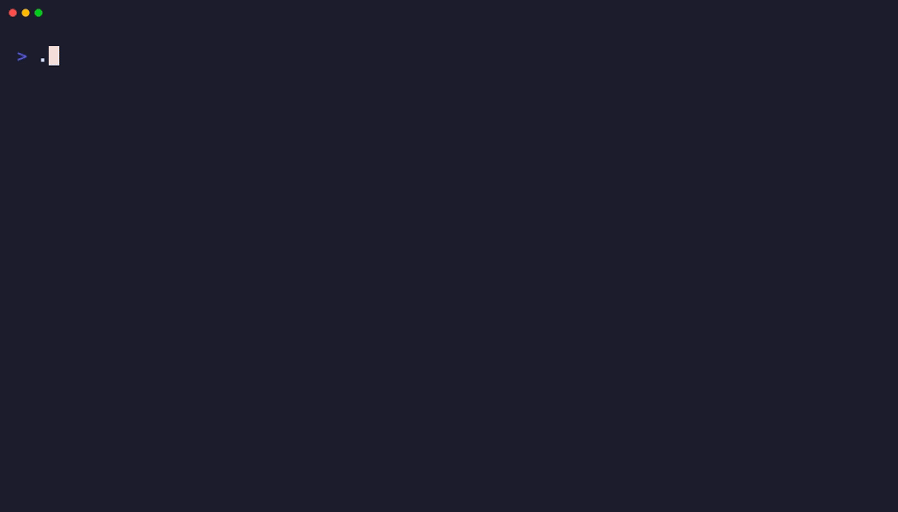

# Muse Spark Go SDK

[](https://github.com/Obedience-Corp/muse-spark-go/actions/workflows/ci.yml)
[](https://pkg.go.dev/github.com/Obedience-Corp/muse-spark-go/pkg/muse)
[](https://github.com/Obedience-Corp/festival)
[](go.mod)
[](LICENSE)

Run the Muse coding agent from Go. Stream responses, manage persistent conversations, handle permission requests, and cancel work through Muse's native CLI and Muse Session Protocol (MSP).

The SDK wraps an installed Muse binary. Muse owns model access, authentication, workspace policy, and session storage. The Go package owns subprocesses, protocol transport, event routing, and cancellation.

**Status:** initial `v0.1.0` release. Tested with Muse Code **1.4.14** on macOS arm64, Linux arm64, and Linux amd64. The public API may change before v1. See [compatibility and validation](docs/COMPATIBILITY.md) for the tested surface and remaining limits.

## Features

- One-shot prompts and JSONL streaming with context cancellation.
- Long-lived MSP hosts with multiple sessions, durable resume, and history replay.
- Per-turn event streams, repeatable terminal waits, and independent event subscriptions.
- Native cancel and interrupt commands, including queued-turn reclamation.
- Approval and user-input payloads, explicit presentation receipts, and separate decisions.
- Typed errors, raw payload preservation, bounded queues, and explicit delivery-gap errors.
- Seven runnable demos, modular Just recipes, protocol fixtures, and real-binary checks.

## Installation

Requires Go 1.24+ and Muse available on `PATH` or at an explicit path. Install and authenticate Muse separately before using a model provider. Echo demos need no model credentials.

The module is public and can be installed through the standard Go module proxy:

```sh
go get github.com/Obedience-Corp/muse-spark-go/pkg/muse@v0.1.0
```

See the [changelog](CHANGELOG.md) for release notes. The SDK does not install or update Muse. Set `MUSE_NO_AUTO_UPDATE=1` when using its launcher with a pinned version.

## Quick start

```go
package main

import (
    "context"
    "fmt"
    "log"
    "time"

    "github.com/Obedience-Corp/muse-spark-go/pkg/muse"
)

func main() {
    ctx, cancel := context.WithTimeout(context.Background(), time.Minute)
    defer cancel()

    client, err := muse.NewClientFromPath()
    if err != nil {
        log.Fatal(err)
    }
    result, err := client.RunPromptCtx(ctx, "Hello from Go", &muse.RunOptions{
        Provider: "echo",
        Preset: "empty",
        NoSessionLog: true,
        NoForeignPersonalContext: true,
        DisableRequestUserInput: true,
    })
    if err != nil {
        log.Fatal(err)
    }
    fmt.Println(result.Text)
}
```

For a coding task, select your configured provider and workspace through `RunOptions`. `NewClient("/path/to/muse")` selects an explicit executable. `Client.WorkingDir`, `Client.Env`, and per-host options control process configuration; configure a client before sharing it between goroutines.

## Demos



Every demo runs the actual Muse binary using the echo provider and a fresh, disposable configuration directory. Session files are removed when the demo exits. The recording above shows real SDK calls on macOS; [the source tape](docs/demos/muse.tape) reproduces it.

```sh
just demo basic        # Structured one-shot response
just demo streaming    # JSONL records as they arrive
just demo sessions     # Two turns through one host
just demo resume       # Restart, resume the same ID, replay history
just demo cancel       # Native cancellation and interruption
just demo permissions  # Restrictive mode and pending-request inspection
just demo errors       # Process errors and context cancellation

just demo sessions --interactive  # Prompt loop; /quit exits
```

See [the demo guide](docs/DEMOS.md) for prerequisites, expected output, and the network-disabled container runner.

## Streaming prompts

```go
events, errs := client.StreamPrompt(ctx, "Explain this package", opts)
for event := range events {
    fmt.Println(event.Type, string(event.Payload))
}
if err := <-errs; err != nil {
    return err
}
```

The error channel contains at most one transport, process, or decoding error and closes when execution ends. Drain events or cancel the context. Runtime task failures can precede a successful run terminal; inspect `run.terminal.*` for the run outcome. `RunPromptCtx` performs that aggregation and returns both the result and an error for a failed or cancelled terminal when available.

## Sessions and turn streams

```go
host, err := client.StartMSP(ctx, muse.HostOptions{
    Provider: "echo",
    NoSessionLog: true,
})
if err != nil {
    return err
}
defer host.Close(context.Background())

session, err := host.StartSession(ctx, muse.SessionOptions{
    WorkspaceRoot: workspace,
})
if err != nil {
    return err
}
turn, err := session.SendWithOptions(ctx, []muse.InputPart{muse.Text("Hello")},
    muse.TurnOptions{Stream: true})
if err != nil {
    return err
}
for event := range turn.Events() {
    fmt.Println(event.Method, string(event.Params))
}
result, err := turn.Wait(ctx)
if err != nil {
    return err
}
if result.Terminal != "completed" {
    return fmt.Errorf("turn ended: %s", result.Terminal)
}
```

`Send` is the wait-only convenience method; `SendWithOptions` enables streaming. Admission is separate from completion, and a nil `Wait` error means the terminal is known. Inspect `Terminal` for `completed`, `failed`, `cancelled`, `unqueued`, or a future value. `Wait` is safe to call repeatedly and concurrently.

Cancelling a wait does not stop an admitted native turn. Call `turn.Cancel(ctx)` or `turn.Interrupt(ctx)`, then wait for the terminal. `CloseTracking` releases local tracking when abandoning a turn; closing the host releases all tracking. Always close owned hosts.

For durable sessions, leave `NoSessionLog` false and save `session.Info.SessionID`. A new host using the same Muse data directory can call `ResumeSession`. Memory-only sessions cannot survive a host restart.

## Permissions and events

`host.Requests()` delivers approval and input requests. Decode them with `Request.Approval()` or `Request.Input()`, present them to the user, and send a receipt with `RespondContext`. Submit the chosen server-provided choice and requirement through `DecideApproval`; answer questions with `AnswerInput` and `[]muse.InputAnswer`. A receipt never grants permission. User-input dialogs are disabled unless the host explicitly advertises support.

Use `host.Subscribe(sessionID, capacity)` for an independent session stream. Register before starting commands, drain `Events()`, inspect `Err()` after closure, and call `Close` when finished. Slow subscribers fail with `ErrOverflow` without blocking other consumers. `view/gap` ends affected turn tracking with `ErrGap`; `ReplayView` retrieves durable history for recovery. The application owns reconciliation with live events and its displayed state.

See [MSP lifecycle and recovery](docs/MSP.md) for approval handling, cursor semantics, and failure behavior. Raw `Call` and `NotifyContext` cover advanced protocol methods without implying typed support for the entire Muse CLI.

## Development

```sh
just --list --list-submodules
just check                 # Build, tests, vet, formatting
just test race
just test container 1.24   # Network-disabled Linux checks
just test container 1.26
just build cross           # Linux, macOS, Windows × amd64, arm64
```

Recipes live in `.justfiles/`. Filesystem-mutating integration checks run inside disposable containers. See [contributing](docs/CONTRIBUTING.md), [compatibility](docs/COMPATIBILITY.md), and [review evidence](docs/REVIEW.md).

## Related

- [Claude Code Go SDK](https://github.com/lancekrogers/claude-code-go)
- [Grok Go SDK](https://github.com/lancekrogers/grok-go-sdk)
- [Festival](https://github.com/Obedience-Corp/festival)

## License

[Apache License 2.0](LICENSE). Muse is distributed separately under its own terms.
